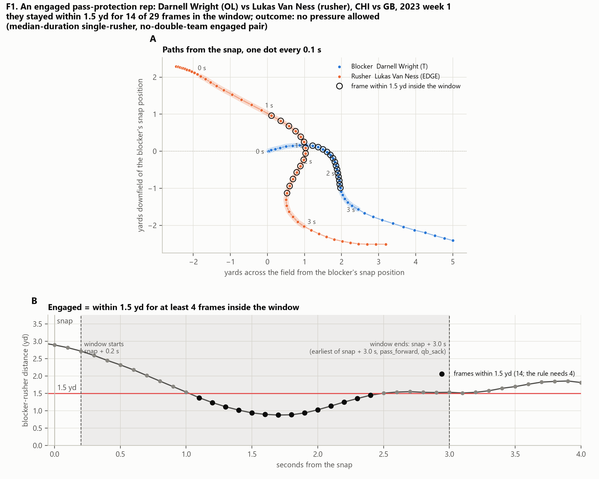
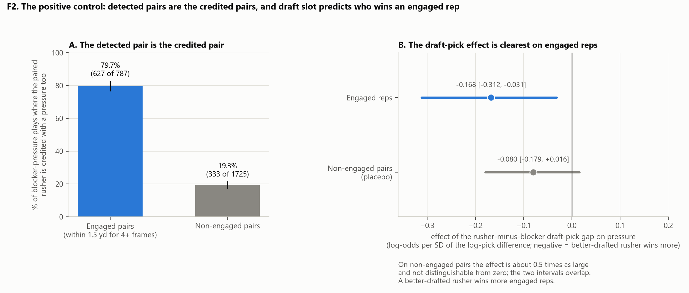
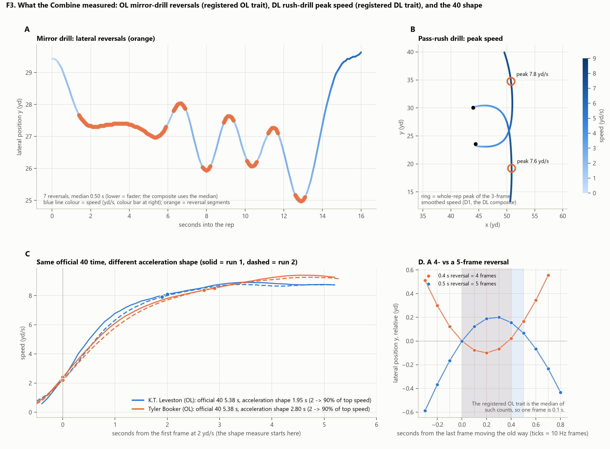
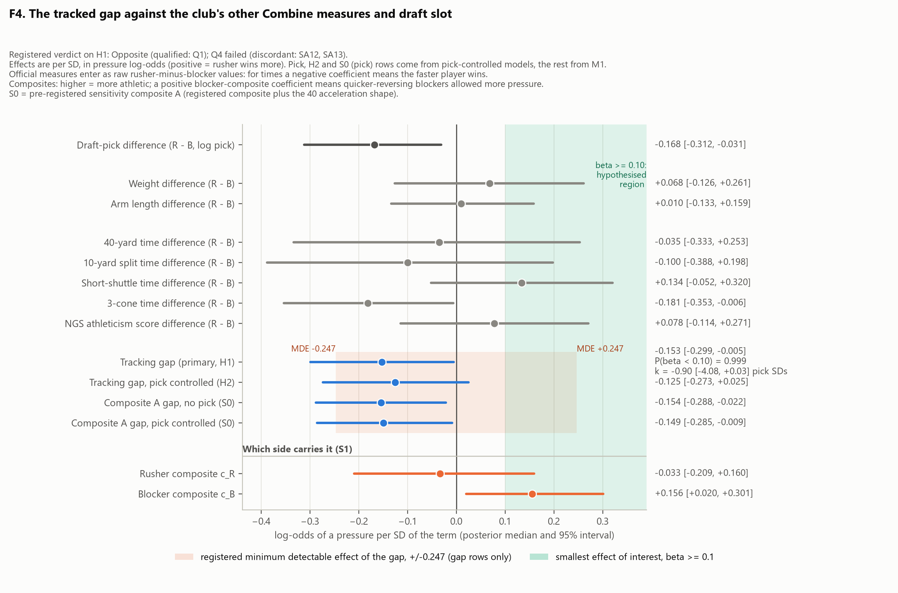
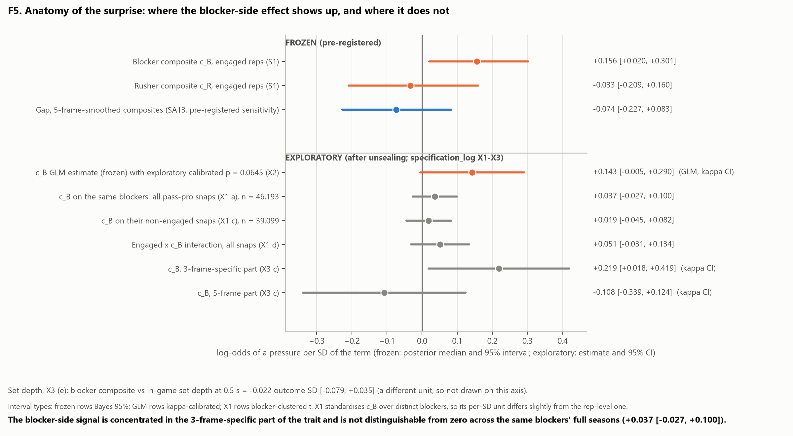
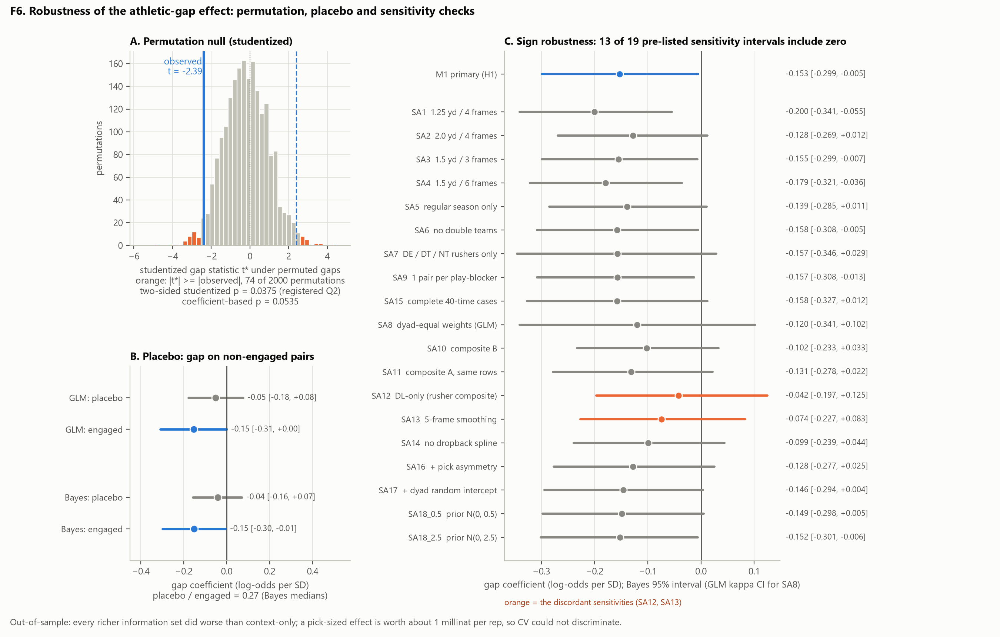

# Two tracked Combine drill traits did not win NFL pass-protection reps: a pre-registered test

## The question

Every lineman at the Combine is tracked at 10 Hz. Does any of it predict who wins NFL pass-protection reps once a club already has size, stopwatch times, the Next Gen Stats (NGS) athleticism score and, later, draft slot? We test two tracked drill traits, through the engaged one-on-one rep, against whether the blocker allowed a pressure. The expected edge was ruled out. The reusable product is the rep-level engine; code is in the public repository.

## 1. The rep engine: finding the rep that decides a pressure

Game tracking covers only the 510-player Combine cohort, so most matchups are invisible. We keep plays where a cohort blocker and a cohort rusher were within 1.5 yards on at least four frames (0.4 s, not necessarily consecutive) between 0.2 s after the snap and the earliest of 3.0 s, the throw or a sack (F1). That yields 8,271 engaged reps among 29,269 co-occurring pairs.

When the blocker is charged with a pressure, the engaged rusher is credited with one 79.7% of the time (627 of 787), against 19.3% (333 of 1,725) for pairs on the same play that never engaged (F2A).

Positive control: draft slot should predict who wins, and it does. The pre-registered check gives -0.204 log-odds per SD of the pick difference (SE 0.049, 8,271 reps); the full model gives -0.168 [-0.312, -0.031]. On non-engaged pairs the effect was about half as large (ratio 0.48; pre-registered expectation about 0.37); the two were not tested against each other, and 2,882 of the 17,795 non-engaged pairs share a play and blocker with an engaged rep, so carry the same outcome. Requiring registered traits for both players leaves 7,214 reps, 69 blockers, 97 rushers, 681 pressures (9.4%).

**F1. One engaged rep (Darnell Wright, tackle, against Lukas Van Ness, 2023 week 1; no pressure allowed).** A: paths from the snap. B: blocker-rusher distance; black dots are frames within 1.5 yd (14; the rule needs four).

**F2. The detected pair is the credited pair.** A: share of blocker-pressure plays where the paired rusher is credited too. B: draft-pick effect on engaged and non-engaged pairs; negative: the better-drafted rusher wins more.

## 2. What the Combine measured, and what we registered

We closed the candidate pool before opening the rep-level outcomes (feasibility work had seen draft-pick and weight effects on pressure, as disclosed): 11 tracked traits, definitions frozen. A trait had to repeat across a player's attempts, not copy the stopwatch or size (|r| below 0.75), and exist for 80% of engaged players. Only two passed (T1):

- **Blocker mirror-drill reversal time (O3):** median time to change lateral direction within one rep (at least four reversals).
- **Rusher pass-rush-drill peak speed (D1):** top smoothed speed in the rep.

O3 passes reliability with 3-frame smoothing (0.704) but not 5-frame (0.570); we flagged that before outcomes.

| Trait (drill) | Repeat r | r, 5-frame | Max abs r vs stopwatch/size | Verdict |
|---|---|---|---|---|
| O1 drop peak speed | 0.505 | 0.461 | 0.432 | fail: CI bound |
| O2 drop run time | 0.358 | 0.348 | 0.341 | fail |
| **O3 mirror reversal time** | 0.704 | 0.570 | 0.320 | **pass** |
| O4 40 acceleration shape | 0.708 | 0.615 | 0.276 | fail: coverage |
| O5 40 top speed | 0.924 | 0.925 | 0.907 | fail: stopwatch copy |
| **D1 rush-drill peak speed** | 0.639 | 0.638 | 0.715 | **pass** |
| D2 rush turn speed | 0.415 | 0.393 | 0.278 | fail |
| D3 rush get-off | 0.369 | 0.342 | 0.387 | fail |
| D5 40 acceleration shape | 0.529 | 0.536 | 0.291 | fail: coverage |
| D6 40 top speed | 0.976 | 0.977 | 0.978 | fail: stopwatch copy |

**T1. Which tracked traits are real** (84-118 players each; D4 omitted: two players). Repeat r: across two reps, sides (D1) or runs; O3: odd versus even reversals in one rep. Pass: r 0.50 with interval above 0.30 (O3: 0.60).

**F3. What the Combine measured.** A: mirror-drill reversals (orange). B: pass-rush drill, peak ringed. C: two tackles, same official 40 (5.38 s), different acceleration shapes. D: a 4-frame versus a 5-frame reversal.

**Pre-registration.** A pass-protection rep is a one-on-one matchup, so what should matter is the difference between the two men's quickness, not either alone. H1 tests that athletic gap (rusher composite minus blocker composite) against blocker pressure allowed, beyond both players' weight, arm length, 40, 10-yard split, shuttle, 3-cone and NGS score; expected sign positive. Secondary S1 splits the gap by side. The model is Bayesian logistic with random intercepts for blocker and rusher. Draft slot is excluded from the primary model because it does not exist when a club reads Combine data; it enters H2. Design, power and verdict rules were frozen and hashed before the sealed outcome file was opened; the script ran once. Decision rule: the category follows the Bayesian 95% interval (Supported above zero, Opposite below, otherwise Inconclusive); qualifiers change wording, never the category. The test could detect 0.247 log-odds per SD, with only 26-35% power for half of that.

## 3. The result

The registered label for H1 is: Opposite (qualified: Q1); Q4 failed (discordant: SA12, SA13). Q1 means the frequentist mirror of the model did not agree (its calibrated interval touched zero); Q4 means two pre-listed sensitivity versions disagreed (rusher-only, SA12; 5-frame smoothing, SA13). The estimate is -0.153 log-odds per SD of the gap [-0.299, -0.005], about -1.06 percentage points of pressure per rep [-2.02, -0.10]: a more athletic rusher relative to the blocker went with slightly less pressure, the reverse of the hypothesis. The robust finding is the bound: P(β < 0.10) = 0.999, so the hypothesised edge is ruled out at the registered effect size of interest (0.10, half the pre-registered pick effect of 0.20).

Secondaries carry no confirmatory claim (with about ten, one would exclude zero by chance). With draft slot controlled (H2) the verdict is Inconclusive, -0.125 [-0.273, 0.025]. With the 40 acceleration shape added (S0; 7,720 reps, 75 blockers) it is Opposite, -0.154 [-0.288, -0.022], and -0.149 [-0.285, -0.009] with draft slot; on the primary set's own rows it is -0.131 [-0.278, 0.022], so part of its sharper interval comes from 506 extra reps and six extra blockers.

The opposite sign is weak. The registered permutation check passed (p = 0.0375, two-sided), but the calibrated frequentist interval touches zero ([-0.308, 0.000]); 13 of 19 pre-listed sensitivity fits include zero, and a sceptical N(0, 0.5) prior gives [-0.298, 0.005]. The discordant two: 5-frame -0.074 [-0.227, 0.083], rusher-only -0.042 [-0.197, 0.125]. The bound is the robust part: every sensitivity's upper limit is at most 0.125.

**F4. The tracked gap against the club's other Combine measures and draft slot.** Per-SD effects in pressure log-odds (positive: the rusher wins more). Tracked composites are oriented higher = more athletic; official times are raw rusher-minus-blocker, so a negative time coefficient means the faster player wins.

## 4. Forensics on the surprise

The frozen split (S1) is consistent with the signal sitting on the blocker side: blocker composite +0.156 [0.020, 0.301], rusher composite -0.033 [-0.209, 0.160]. In football terms, blockers who reversed direction faster in the drill allowed slightly more pressure, and quicker rushers did not get more. Everything below is **exploratory**: specified after the frozen result (X2 and X5 blind, the rest written after a first look).

- **Permutation:** the blocker term's calibrated two-sided p is 0.065: not distinguishable from permutation noise.
- **No carry-over:** across the same blockers' 46,193 pass-protection snaps, +0.037 [-0.027, 0.100]; on non-engaged snaps, +0.019 [-0.045, 0.082].
- **Three-frame-specific:** with both versions in one model, the 3-frame part is +0.219 [0.018, 0.419] and the 5-frame part -0.108 [-0.339, 0.124] (calibrated intervals).
- **Not a one-frame artefact:** against the 0.50 s reference, fast reversers (0.45 s or less) are +0.214 [-0.014, 0.442] and slow ones (0.55 s or more) -0.215 [-0.596, 0.166], a graded pattern.
- **Later picks:** the blocker effect is larger for later-drafted blockers (+0.136 [0.041, 0.231]), yet the composite does not clearly predict who gets reps, so selection is not established either.
- **No set-depth transfer:** the trait did not predict how far the blocker retreated at 0.5 s (-0.022 SD [-0.079, 0.035]).
- **Rusher trait flat at higher power:** on 19,672 rusher snaps (98 linemen), peak speed gave +0.021 [-0.112, 0.155] on pressure.

We cannot name a mechanism. The effect does not carry over to the same blockers' seasons and lives in the 3-frame-specific part of the trait, which is why we read it as fragile rather than as a football finding.

**F5. Anatomy of the surprise.** The blocker-side signal is fragile (frozen rows) and does not survive the exploratory checks (grey): it is not distinguishable from zero over the same blockers' full seasons, sits in the 3-frame-specific part of the trait, and does not show up in how far the blocker retreats. The +0.143 GLM estimate is frozen; only its permutation p is exploratory.

**F6. Robustness.** A: studentized permutation null, observed t -2.39, p = 0.0375 (coefficient-based 0.0535). B: the gap on non-engaged pairs. C: all 19 pre-listed sensitivities; 13 include zero; SA12 and SA13 in orange. Cross-validation was too insensitive to detect even draft slot (worth about 1 millinat per rep); every richer information set did worse than context-only.

## 5. What it means for scouting

Once you have a lineman's size, stopwatch times and NGS score, the two tracked drill traits gave no positive edge on 7,214 NFL pass-protection reps; half the draft-slot effect is ruled out. Draft slot predicted who wins (T2).

| Term | Effect on engaged reps, log-odds per SD | Direction | Verdict |
|---|---|---|---|
| Draft slot | -0.168 [-0.312, -0.031]; calibrated [-0.280, 0.004] | better-drafted rusher wins | predictive (calibrated interval touches zero) |
| Weight; arm length | +0.068 [-0.126, 0.261]; +0.010 [-0.133, 0.159] | none | nothing detected |
| 40; 10-yard split; shuttle | -0.035 [-0.333, 0.253]; -0.100 [-0.388, 0.198]; +0.134 [-0.052, 0.320] | none; shuttle unexpected | nothing detected |
| 3-cone (raw time) | -0.181 [-0.353, -0.006] | faster rusher wins | expected direction; calibrated interval includes zero |
| NGS athleticism | +0.078 [-0.114, 0.271] | none | nothing detected |
| Blocker's mirror quickness (S1) | +0.156 [0.020, 0.301] | unexpected: quicker blockers allowed more | do not use; fragile |
| Rusher's rush-drill speed (S1) | -0.033 [-0.209, 0.160] | none | nothing beyond the 40 (r 0.715) |

**T2. What to use.** Official measures are rusher-minus-blocker differences (M1; draft slot from M2); the last two rows are single-side terms. "Nothing detected" means the interval includes zero, not proof of no effect. With seven official-measure differences, one or two unexpected-direction rows are expected by chance.

**Measurement recommendation.** A single 10 Hz mirror rep is too coarse. O3 takes six values among 69 blockers, 35 of them tied at 0.50 s, while one frame is 0.1 s. The Combine could record several mirror reps per player, report raw reversal times, sample faster, and add body orientation (game tracking has it; Combine tracking does not).

## 6. The engine as a tool, and limits

Any club can point the engine at its own Combine metric: add a player-level value to the same model and read the bound. The notebook rebuilds the pipeline, positive control and figures from raw files and loads the frozen Bayesian results.

Limits: 69 blockers, 97 rushers; first three NFL seasons only (2,804 rookie, 2,587 second-year, 1,823 third-year blocker reps); the outcome is the NGS-attributed pressure, shared by a blocker's pairs on a play, with no quarterback in the tracking; opponents are Combine defensive linemen only; trait reliabilities (0.83 and 0.78) attenuate effects; 11 traits were tried, two passed the gates.

*Data: Big Data Bowl 2027 (CC BY-NC 4.0); pre-registration and logs in the repository.*
